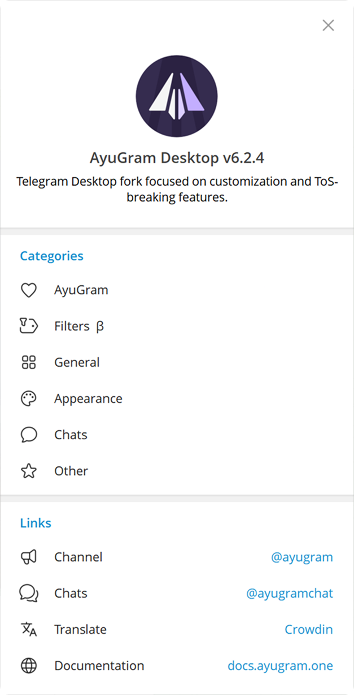
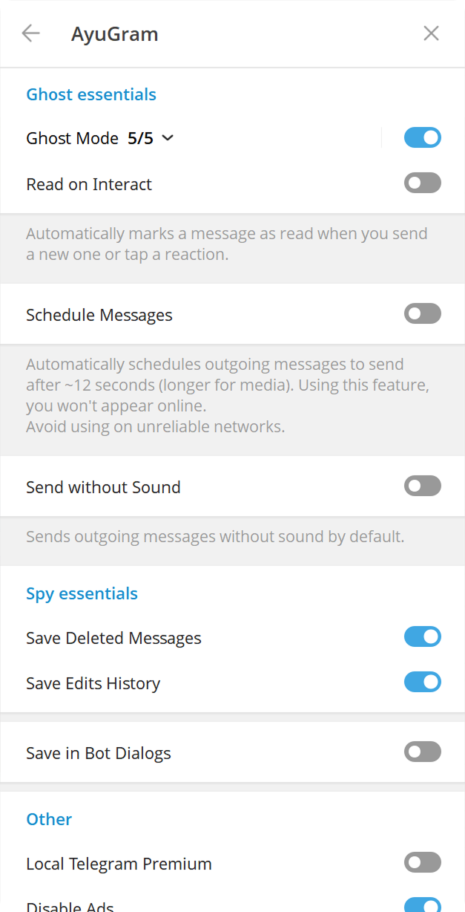
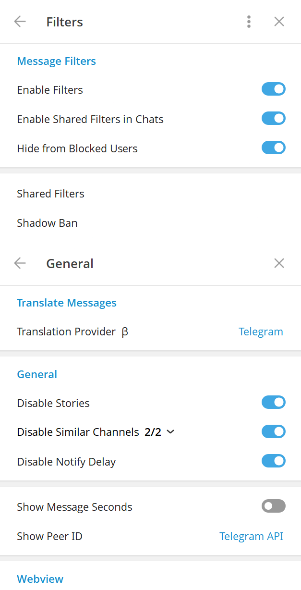
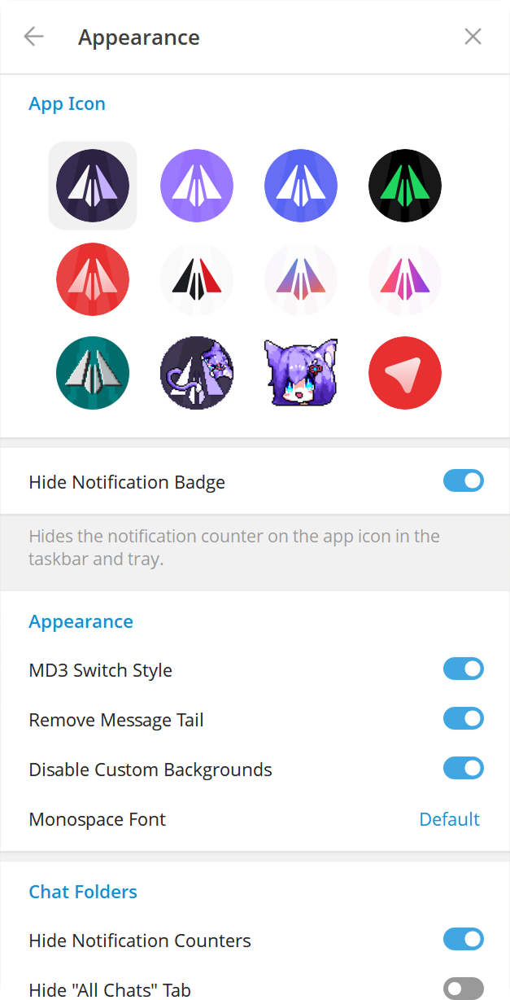
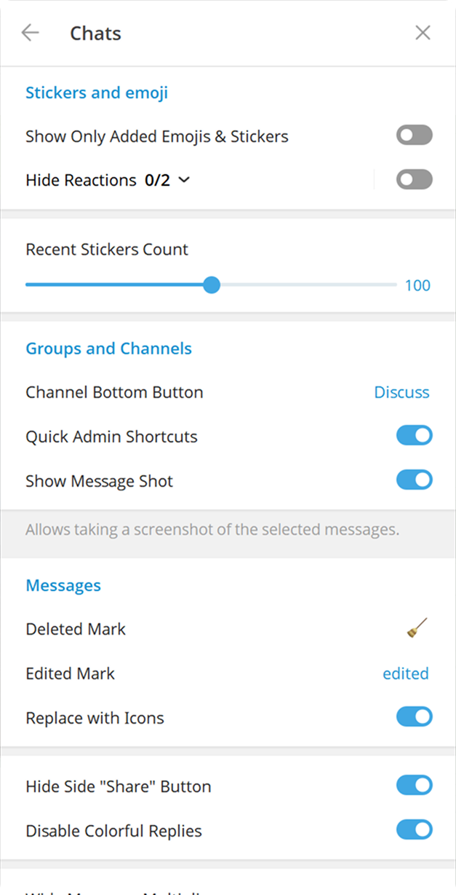

# YamiGram

Форк Telegram Desktop с упором на кастомизацию и обход ограничений.

[ [English](README.md)  | Русский ]

## Функции и Фишки

- Полный режим призрака (настраиваемый)
- История удалений и изменений сообщений
- Кастомизация шрифта
- Режим Стримера
- Локальный телеграм премиум
- Переводчик
- Превью медиа и быстрая реакция при сильном нажатии на тачпад (macOS)
- Улучшенный вид

И многое другое.

<h3>
  

    
Превью

    <table>
      <tr>
        <td></td>
        <td></td>
        <td></td>
      </tr>
      <tr>
        <td></td>
        <td></td>
      </tr>
    </table>
  

</h3>

## Сборка

### Windows

Убедитесь, что в VS Build Tools установлены компоненты:

- C++ MFC latest (x86 & x64)
- C++ ATL latest (x86 & x64)
- последний Windows 11 SDK

Затем следуйте [docs/building-win-x64.md](docs/building-win-x64.md).

### Linux

Следуйте [docs/building-linux.md](docs/building-linux.md).

## Ссылки

- Канал: [@yamigram](https://t.me/yamigram)
- Чат: [@yamigramchat](https://t.me/yamigramchat)

## Благодарности

YamiGram — форк [AyuGram](https://github.com/AyuGram/AyuGramDesktop),
который в свою очередь основан на [Telegram Desktop](https://github.com/telegramdesktop/tdesktop).
Спасибо всем, кто сделал эти проекты возможными.

### Клиенты Telegram

- [Telegram Desktop](https://github.com/telegramdesktop/tdesktop)
- [AyuGram](https://github.com/AyuGram/AyuGramDesktop)
- [Kotatogram](https://github.com/kotatogram/kotatogram-desktop)
- [64Gram](https://github.com/TDesktop-x64/tdesktop)
- [Forkgram](https://github.com/forkgram/tdesktop)

### Используемые библиотеки

- [JSON for Modern C++](https://github.com/nlohmann/json)
- [SQLite](https://github.com/sqlite/sqlite)
- [sqlite_orm](https://github.com/fnc12/sqlite_orm)
- [androidx sources](https://github.com/androidx/androidx)

### Иконки

- [Solar Icon Set](https://www.figma.com/community/file/1166831539721848736)
