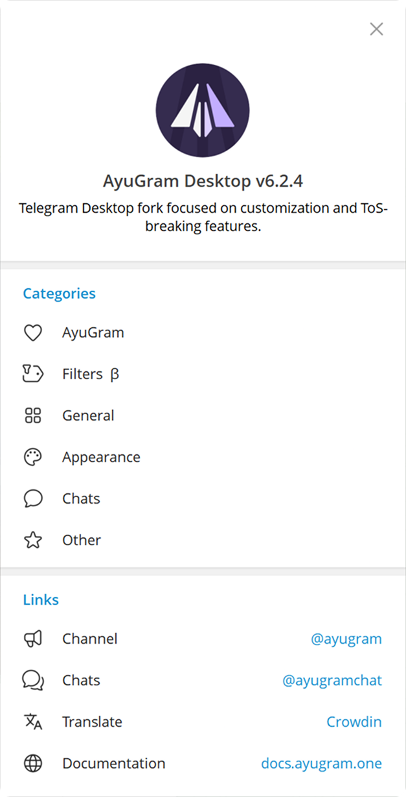
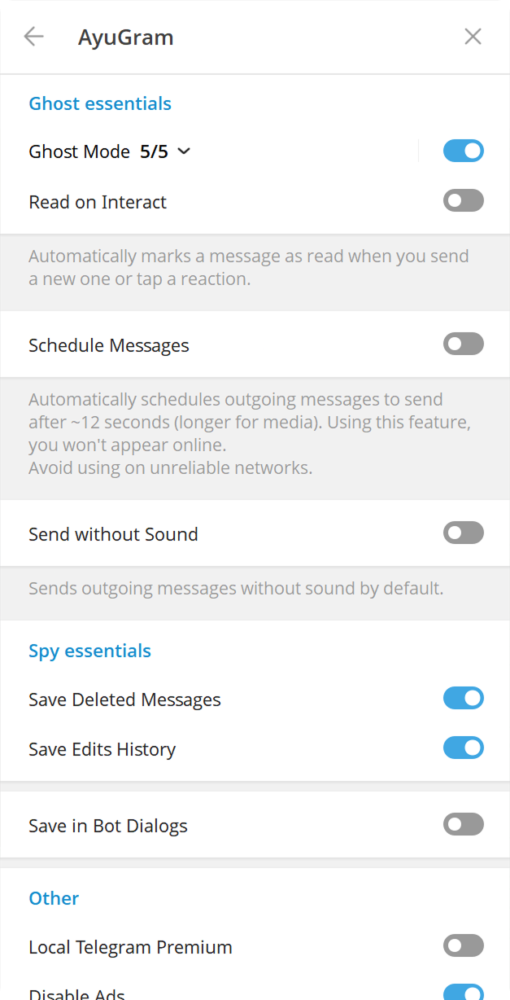
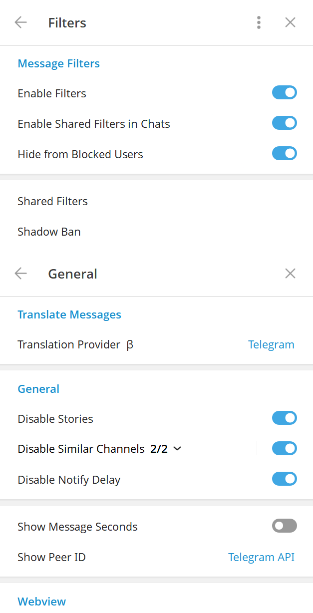
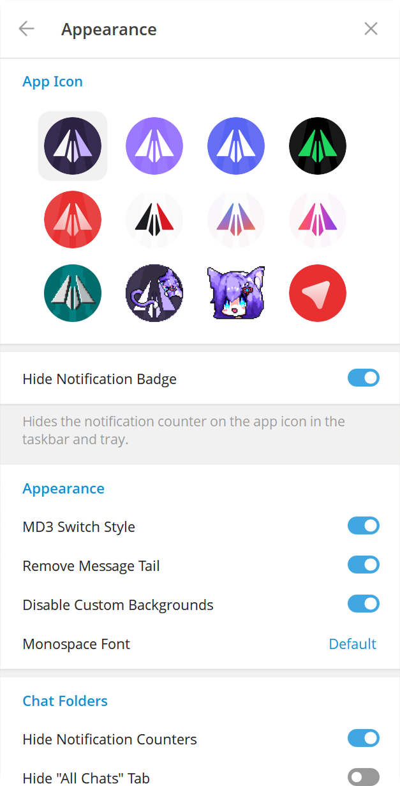
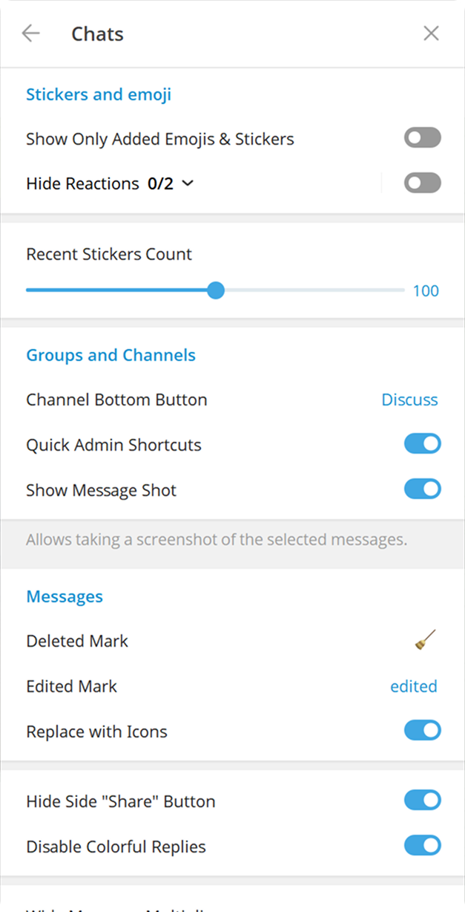

# YamiGram

A Telegram Desktop fork focused on customization and breaking limits.

[ English  |   [Русский](README-RU.md) ]

## Features

- Full ghost mode (flexible)
- Messages history
- Anti-recall
- Font customization
- Streamer mode
- Local Telegram Premium
- Translator
- Media preview & quick reaction on force click (macOS)
- Enhanced appearance

And many more.

<h3>
  

    
Preview

    <table>
      <tr>
        <td></td>
        <td></td>
        <td></td>
      </tr>
      <tr>
        <td></td>
        <td></td>
      </tr>
    </table>
  

</h3>

## Building

### Windows

Make sure you have these components installed with VS Build Tools:

- C++ MFC latest (x86 & x64)
- C++ ATL latest (x86 & x64)
- latest Windows 11 SDK

Then follow [docs/building-win-x64.md](docs/building-win-x64.md).

### Linux

Follow [docs/building-linux.md](docs/building-linux.md).

## Links

- Channel: [@yamigram](https://t.me/yamigram)
- Chat: [@yamigramchat](https://t.me/yamigramchat)

## Credits

YamiGram is a fork of [AyuGram](https://github.com/AyuGram/AyuGramDesktop),
which is itself based on [Telegram Desktop](https://github.com/telegramdesktop/tdesktop).
Thanks to everyone who made those projects possible.

### Telegram clients

- [Telegram Desktop](https://github.com/telegramdesktop/tdesktop)
- [AyuGram](https://github.com/AyuGram/AyuGramDesktop)
- [Kotatogram](https://github.com/kotatogram/kotatogram-desktop)
- [64Gram](https://github.com/TDesktop-x64/tdesktop)
- [Forkgram](https://github.com/forkgram/tdesktop)

### Libraries used

- [JSON for Modern C++](https://github.com/nlohmann/json)
- [SQLite](https://github.com/sqlite/sqlite)
- [sqlite_orm](https://github.com/fnc12/sqlite_orm)
- [androidx sources](https://github.com/androidx/androidx)

### Icons

- [Solar Icon Set](https://www.figma.com/community/file/1166831539721848736)
